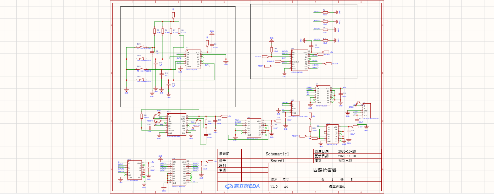
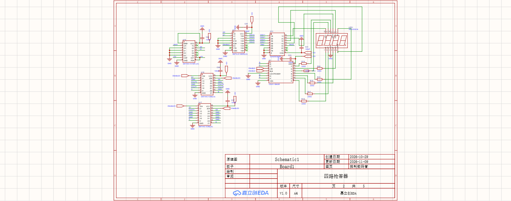
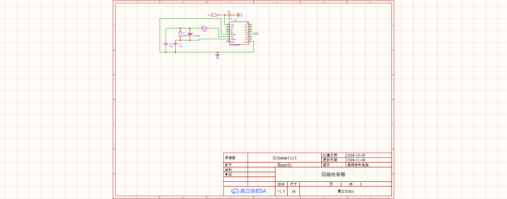
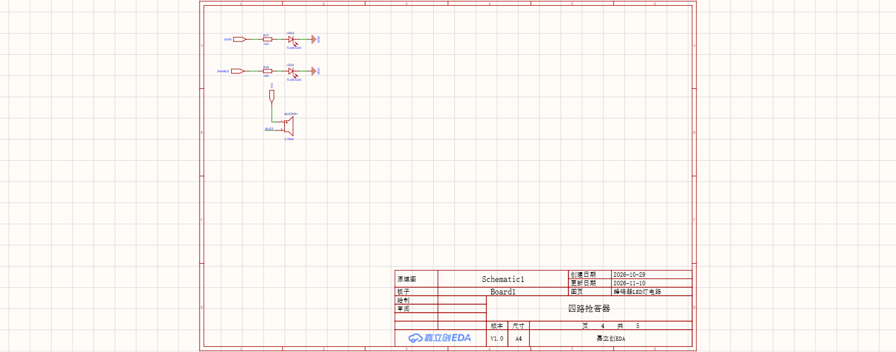
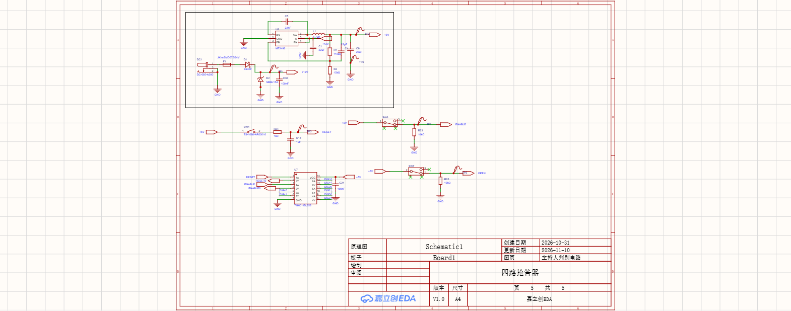
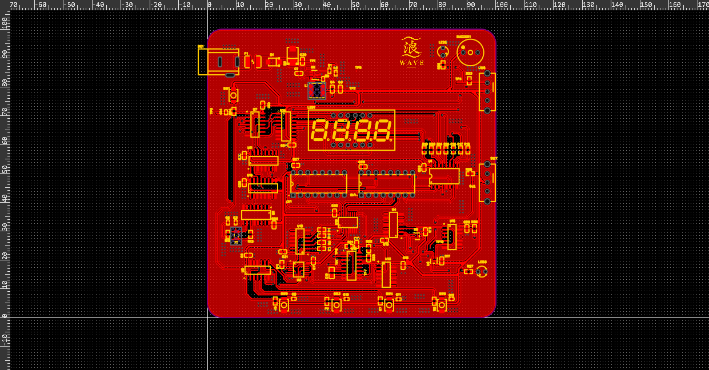
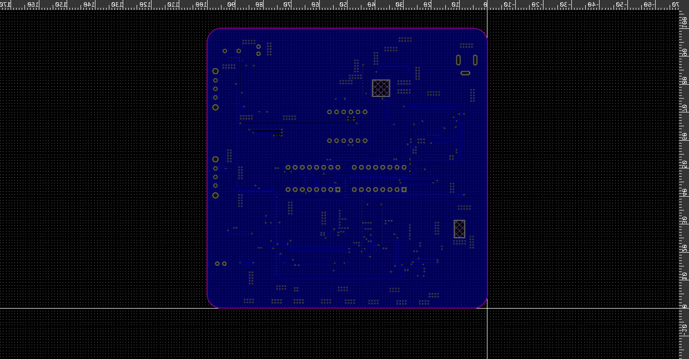

# 四路竞赛抢答器

自己做的第一个完整自己设计的PCB项目，虽然只是一个课设。

> 不依赖单片机、不联网，核心抢答与显示功能全部由数字逻辑电路实现。

[EasyEDA 工程](ProPrj_四路抢答器_2026-11-10.epro2) ·
[源码快照归档](source-archive/FourChannelQuizBuzzer-Snapshot-Split) ·
[原理图](#原理图) ·
[PCB](#pcb)

## 项目简介

本项目是一套四路竞赛抢答器，用于四组选手的首答识别、组别锁存和数码管显示。系统采用纯数字逻辑方案，不使用单片机、软件固件或网络通信，适合数字电路课程设计、逻辑电路验证和 PCB 实践。

## 主要功能

- 支持四路独立抢答输入
- 主持人通过 `ENABLE` 控制抢答开放
- 锁存首个有效抢答组别，抑制后续输入
- 四位数码管显示抢答组别
- 支持主持人复位
- 按键 RC 消抖与施密特整形
- 蜂鸣器和状态 LED 提示
- 支持提前抢答状态检测
- 独立的振荡、计数和动态扫描显示电路

## 系统工作流程

```text
四路答题按键
    ↓ RC 消抖与 74HC14 整形
CD4043 首答锁存
    ↓
CD4078 状态汇总
    ↓
CD74HC221 脉冲控制
    ↓
74HC573 结果快照
    ↓
74HC153 / CD4511 / ULN2003
    ↓
四位数码管
```

## 主要器件

| 功能模块 | 主要器件 |
|---|---|
| 输入消抖与整形 | `74HC14` |
| 首答锁存 | `CD4043` |
| 状态汇总 | `CD4078` |
| 脉冲与显示时序 | `CD74HC221` |
| 结果锁存 | `74HC573` |
| 振荡与分频 | `CD4060` |
| 显示扫描与控制 | `74HC161`、`SN74LS138`、`74HC153` |
| 数码管译码与驱动 | `CD4511`、`ULN2003` |
| 电源转换与保护 | `MT2492`、`SS34F`、`SMBJ15A` |

## 原理图

<table>
  <tr>
    <td align="center" width="50%">
      
      <br><sub>图 1　判别电路</sub>
    </td>
    <td align="center" width="50%">
      
      <br><sub>图 2　控制数码管</sub>
    </td>
  </tr>
  <tr>
    <td align="center" width="50%">
      
      <br><sub>图 3　晶振控制电路</sub>
    </td>
    <td align="center" width="50%">
      
      <br><sub>图 4　蜂鸣器 LED 灯电路</sub>
    </td>
  </tr>
  <tr>
    <td align="center" colspan="2">
      
      <br><sub>图 5　主持人判别电路</sub>
    </td>
  </tr>
</table>

## PCB

PCB 为两层板，设计包含顶层走线、底层走线、覆铜和丝印。

<table>
  <tr>
    <td align="center" width="50%">
      
      <br><sub>PCB 顶层</sub>
    </td>
    <td align="center" width="50%">
      
      <br><sub>PCB 底层镜像视图</sub>
    </td>
  </tr>
</table>

## 使用方法

1. 使用 EasyEDA 打开仓库中的 `ProPrj_四路抢答器_2026-11-10.epro2`。
2. 接入设计规定的直流电源，无需烧录固件。
3. 上电后先保持 `ENABLE` 关闭，并执行一次复位。
4. 主持人开启 `ENABLE` 后，第一个有效抢答输入被锁存并显示。
5. 新一轮比赛前关闭 `ENABLE`，执行复位，再重新开放抢答。

## 仓库结构

```text
.
├─ ProPrj_四路抢答器_2026-11-10.epro2
├─ README.md
├─ docs/
│  └─ images/
│     ├─ schematic-01-discriminator.png
│     ├─ schematic-02-display-control.png
│     ├─ schematic-03-oscillator.png
│     ├─ schematic-04-buzzer-led.png
│     ├─ schematic-05-host-judge.png
│     ├─ pcb-top.png
│     └─ pcb-bottom.png
└─ source-archive/
   └─ FourChannelQuizBuzzer-Snapshot-Split/
```

## 说明

本工程主要用于课程设计与数字逻辑验证。复刻或制板前，建议结合实际器件数据手册再次检查电源余量、逻辑电平、LED 额定电流以及 PCB 可制造性。
